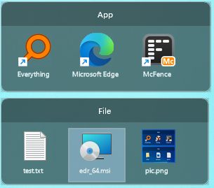
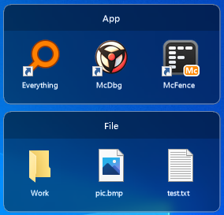
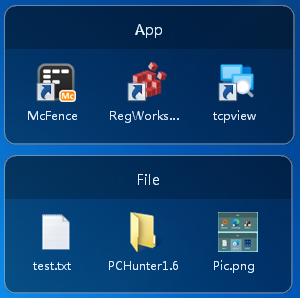

# McFence

**A lightweight, open-source Windows desktop fence tool — a free alternative to Stardock Fences that runs everywhere from Windows XP to Windows 11.**

English | [简体中文](README.zh-CN.md)

[](#compatibility)
[](#download)
[](#tech-stack)
[](#download)
[](LICENSE)
[](https://github.com/McSafeNet/McFence/stargazers)
[](https://github.com/McSafeNet/McFence/releases)

McFence collects shortcuts, files and folders into translucent "fences" on your desktop. Items can be reordered, moved between fences, dragged out to Explorer, mapped from real folders, locked and rolled up. It is a single native Win32 executable with no .NET, no VC++ runtime and no installer — copy it anywhere and run.

| Windows 11 | Windows 10 | Windows 7 |
| --- | --- | --- |
|  |  |  |

## At a glance

| | |
| --- | --- |
| **Platform** | Windows XP SP3 / Vista / 7 / 8 / 8.1 / 10 / 11, x86 and x64 |
| **Technology** | C++, Win32 API, GDI+, layered windows, built with the VS2017 `v141_xp` toolset |
| **Footprint** | Single exe (~680 KB), static CRT, no dependencies, portable |
| **Storage** | Local only — `%LOCALAPPDATA%\McFence`, plain XML / INI |
| **License** | [MIT](LICENSE) |

## Download

Grab the latest `McFence.exe` from [GitHub Releases](https://github.com/McSafeNet/McFence/releases):

- **x64** — recommended for 64-bit Windows.
- **x86** — for 32-bit Windows, including Windows XP SP3.

## Quick start

1. Download `McFence.exe`, put it in any folder and double-click it.
2. A default fence appears on the desktop and a tray icon is added.
3. Drag files, shortcuts or folders from the desktop or Explorer into the fence (moved by default, hold Ctrl to copy).
4. Right-click the tray icon to create fences, map folders, enable start with Windows, or open Options.
5. Press **Ctrl+Alt+F** (or double-click an empty spot on the desktop) to hide / show all fences.

## Features

### Fences and items

- **Desktop fences** — translucent, rounded panels drawn with per-pixel alpha; background blur on Windows 10/11.
- **Drag in** — drop anything from the desktop or Explorer; items are **moved** into the fence's store under `Items\` by default, hold **Ctrl** to copy instead.
- **Drag out** — drag selected items outside all fences to start a real system drag: drop them into Explorer, onto the desktop, or into other apps. Moves by default, hold **Ctrl** to copy.
- **Between fences** — move items between fences, or reorder within a fence.
- **Explorer-style names** — full file names with extensions; shortcuts (`.lnk`, `.url`, …) hide their extension and show the standard shortcut arrow, just like the desktop.
- **Folder mapping** — a fence can show the live contents of a real folder and refreshes automatically when it changes.
- **Multi-select** — click, Ctrl+click, rubber-band selection, Ctrl+A, Esc to clear.
- **Sorting** — manual, or by name (natural sort: `file2` before `file10`), date, size, type; ascending / descending; folders first.
- **In-place rename** — F2 edits the label directly on the icon, the extension stays fixed; double-click the title bar to rename a fence.
- **Shell integration** — the real Explorer context menu (Shift+right-click for the extended menu) and Explorer's own "New" submenu.
- **Recycle Bin delete** — Del sends files to the Recycle Bin instead of deleting them permanently.

### Desktop behavior

- **Tray icon** — double-click to show / hide everything; right-click for new fence, map folder, start with Windows, options, data folder and exit.
- **Global hotkey** — Ctrl+Alt+F by default, configurable or removable in Options.
- **Double-click desktop** — double-click a blank desktop area to hide / show all fences (icons are not affected).
- **Snapping** — fences snap to screen edges and to each other while moving or resizing; hold Alt to disable temporarily.
- **Move together** — hold Ctrl while dragging a title bar to move all unlocked fences at once.
- **Lock and roll-up** — lock a fence in place, or let it collapse to its title bar automatically.
- **Survive Win+D** — optionally keep fences visible when "Show desktop" is used.
- **Multi-monitor & DPI** — fences that end up off-screen are moved back; Per-Monitor V2 DPI on Windows 10/11.
- **Explorer restart** — fences and the tray icon come back automatically when Explorer restarts.
- **Start with Windows** — per user via `HKCU\...\Run`, no administrator rights required.

## Compatibility

Everything newer than Windows XP is detected at runtime, so the same exe adapts to the system it runs on:

| Capability | Windows XP | Windows 7 | Windows 8 / 8.1 | Windows 10 / 11 |
| --- | --- | --- | --- | --- |
| Per-pixel alpha panels | ✓ | ✓ | ✓ | ✓ |
| Background blur | — | — | — | ✓ |
| High-resolution icons | Large icons | Jumbo icons | Jumbo icons | Jumbo icons |
| DPI awareness | — | System DPI | Per-Monitor | Per-Monitor V2 |
| Thumbnails, drag-out, natural sort | ✓ | ✓ | ✓ | ✓ |

## Build

Requirements: Visual Studio 2017 or later with the **"C++ Windows XP Support for VS 2017 (v141) tools"** component.

```powershell
git clone https://github.com/McSafeNet/McFence.git
cd McFence
msbuild McFence.sln /p:Configuration=Release /p:Platform=x64
msbuild McFence.sln /p:Configuration=Release /p:Platform=x86
```

Output: `Release\x64\McFence.exe` and `Release\x86\McFence.exe`.

One-step verification (build both platforms, check PE headers / imports for XP safety, XML round-trip test, render snapshots):

```powershell
powershell -NoProfile -ExecutionPolicy Bypass -File .\tools\verify.ps1
```

See [docs/DEVELOPMENT.zh-CN.md](docs/DEVELOPMENT.zh-CN.md) (Chinese) for architecture, coding conventions, data format and the manual test checklist.

## Project layout

```text
McFence/
├── McFence.sln
├── McFence/                 Source code and resources
│   ├── McFence.cpp          Entry point, tray, hotkey, main loop
│   ├── McFenceWnd.*         Fence window: paint, hit-test, selection, drag & drop, menus, snapping
│   ├── McSurface.*          Layered window surface (GDI+ → premultiplied DIB → UpdateLayeredWindow)
│   ├── McStore.*            XML storage, fence index, item store, sorting
│   ├── McSettings.*         settings.ini and start with Windows
│   ├── McShellOps.*         Drag-out data object, copy / move / recycle, "New" menu
│   ├── McShellMenu.*        Native Shell context menu
│   ├── McDesktop.*          Desktop window lookup, double-click hook, folder watcher
│   ├── McIcons.*            Icon and thumbnail cache
│   ├── McCompat.h           XP safety layer: dynamic API table and constants
│   └── ...
├── tools/
│   ├── seed.ps1             Create isolated test data
│   └── verify.ps1           Automated verification
├── docs/                    Developer documentation
└── pic/                     Screenshots
```

## Data and privacy

McFence never connects to the network. All data stays on your PC:

```text
%LOCALAPPDATA%\McFence\<guid>\__fence_metadata.xml   Per-fence configuration
%LOCALAPPDATA%\McFence\fences.index                 Fence order
%LOCALAPPDATA%\McFence\settings.ini                 Global options
%LOCALAPPDATA%\McFence\Items\                       Files and shortcuts dropped into fences
%LOCALAPPDATA%\McFence\app_diag.log                 Diagnostic log
```

To uninstall, exit McFence from the tray, move anything you want to keep out of `%LOCALAPPDATA%\McFence\Items` (items dragged into fences live there), then delete the exe and the `%LOCALAPPDATA%\McFence` folder.

## Tech stack

- **Language**: C++ (MSVC, `v141_xp`), Unicode Win32
- **Windows**: `WS_EX_LAYERED` + `UpdateLayeredWindow`, owned by `SHELLDLL_DefView`
- **Rendering**: GDI+ into a premultiplied DIB
- **Shell**: `IContextMenu2/3`, custom `IDataObject` + `DoDragDrop`, `SHFileOperation`
- **Runtime**: static CRT (`/MT`); no .NET, no Direct2D, no `api-ms-win-*` imports

## Known limitations

- Text is drawn with GDI+ anti-aliasing; ClearType is not available on per-pixel alpha surfaces.
- No background blur on Windows XP / 7 / 8.
- "Survive Win+D" and "double-click desktop" depend on Explorer's desktop window structure and may not work with third-party desktop replacements.
- Double-click desktop uses a low-level mouse hook, which a few security products may flag; it can be turned off in Options.
- Mapped folders show direct children only, and hide hidden / system files.

## Contributing

Bug reports, ideas and pull requests are welcome via [Issues](https://github.com/McSafeNet/McFence/issues).

## License

[MIT](LICENSE) © Edward (McSafeNet)

## Acknowledgments

- [Stardock Fences](https://www.stardock.com/products/fences/) for the original idea.
- [openFences](https://github.com/weiweigogo/openFrence) and [DeskBox](https://github.com/Tianyu199509/DeskBox), which inspired several features.
- SimpleGrid / NoFences, the projects McFence originally grew out of.

Website: <https://www.mcsafenet.com> · Email: mcsafenet@163.com
