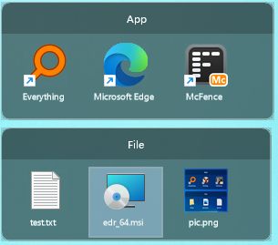
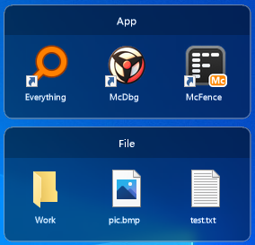
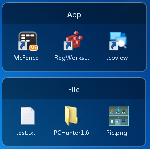

# McFence

**一个轻量级、开源的 Windows 桌面围栏（栅栏）工具 —— Stardock Fences 的免费替代品，从 Windows XP 到 Windows 11 都能运行。**

[English](README.md) | 简体中文

[](#系统要求)
[](#下载)
[](#技术栈)
[](#下载)
[](LICENSE)
[](https://github.com/McSafeNet/McFence/stargazers)
[](https://github.com/McSafeNet/McFence/releases)

McFence 把快捷方式、文件和文件夹收进桌面上半透明的「栅栏」里：可拖动排序、可跨栅栏搬运、可拖出到资源管理器、可映射真实文件夹、可锁定与自动折叠。它是一个原生 Win32 单文件程序，不依赖 .NET、不需要 VC++ 运行库、无需安装 —— 拷贝到任意位置即可运行。

| Windows 11 | Windows 10 | Windows 7 |
| --- | --- | --- |
|  |  |  |

## 概览

| | |
| --- | --- |
| **系统要求** | Windows XP SP3 / Vista / 7 / 8 / 8.1 / 10 / 11，x86 与 x64 |
| **技术** | C++、Win32 API、GDI+、分层窗口，使用 VS2017 `v141_xp` 工具集构建 |
| **体积** | 单个 exe（约 680 KB），静态链接 CRT，无依赖，绿色便携 |
| **数据存储** | 纯本地 —— `%LOCALAPPDATA%\McFence`，XML / INI 明文 |
| **许可证** | [MIT](LICENSE) |

## 下载

从 [GitHub Releases](https://github.com/McSafeNet/McFence/releases) 下载最新的 `McFence.exe`：

- **x64** —— 推荐 64 位 Windows 使用。
- **x86** —— 适用于 32 位 Windows，包括 Windows XP SP3。

## 快速开始

1. 下载 `McFence.exe`，放到任意目录，双击运行。
2. 桌面上出现一个名为「我的栅栏」的栅栏，托盘区出现 McFence 图标。
3. 把桌面或资源管理器里的文件、快捷方式、文件夹拖进栅栏（默认移动，按住 Ctrl 复制）。
4. 右键托盘图标：新建栅栏、新建文件夹映射栅栏、开机启动、选项。
5. 按 **Ctrl+Alt+F**（或双击桌面空白处）隐藏 / 显示全部栅栏。

## 功能特性

### 栅栏与项目

- **桌面栅栏** —— 逐像素 alpha 绘制的半透明圆角面板；Windows 10/11 上带背景模糊。
- **拖入** —— 从桌面或资源管理器拖入任意内容，默认**移动**到 `Items\` 仓库中，按住 **Ctrl** 则复制。
- **拖出** —— 选中项拖出所有栅栏之外即成为系统拖拽，可放到资源管理器、桌面或其他程序；默认移动，按住 **Ctrl** 复制。
- **栅栏间搬运** —— 在栅栏之间移动项目，或在栅栏内拖动调整顺序。
- **与资源管理器一致的名称** —— 显示带扩展名的完整文件名；快捷方式（`.lnk`、`.url` 等）隐藏扩展名并显示标准的快捷方式小箭头，和桌面一样。
- **文件夹映射** —— 栅栏可显示真实文件夹的内容，文件夹变化后自动刷新。
- **多选** —— 单击、Ctrl+单击、空白处框选、Ctrl+A，Esc 取消。
- **排序** —— 手动，或按名称（自然排序：`file2` 在 `file10` 前）、日期、大小、类型，升序 / 降序，文件夹总在前。
- **原地重命名** —— F2 直接在图标标签上编辑，扩展名保持不变；双击标题栏重命名栅栏。
- **Shell 集成** —— 资源管理器原生右键菜单（Shift+右键为完整扩展菜单）以及资源管理器自己的「新建」子菜单。
- **回收站删除** —— Del 把文件放进回收站，而不是直接永久删除。

### 桌面行为

- **托盘图标** —— 双击显示 / 隐藏全部；右键：新建、映射文件夹、开机启动、选项、数据文件夹、退出。
- **全局热键** —— 默认 Ctrl+Alt+F，可在选项中修改或清除。
- **双击桌面** —— 双击桌面空白处显示 / 隐藏全部栅栏（双击桌面图标不会触发）。
- **吸附** —— 移动或缩放时吸附屏幕边缘与其他栅栏，按住 Alt 临时关闭。
- **整体移动** —— 按住 Ctrl 拖动标题栏，所有未锁定的栅栏一起移动。
- **锁定与折叠** —— 锁定栅栏位置，或让栅栏自动折叠为标题栏。
- **Win+D 保留** —— 可选：按 Win+D「显示桌面」时栅栏仍然可见。
- **多显示器与 DPI** —— 跑到屏幕外的栅栏会自动挪回；Windows 10/11 支持 Per-Monitor V2 DPI。
- **资源管理器重启** —— Explorer 重启后，栅栏与托盘图标自动恢复。
- **开机启动** —— 写入当前用户 `HKCU\...\Run`，无需管理员权限。

## 系统要求

Windows XP 之后的能力全部在运行时探测，同一个 exe 会根据系统自动适配：

| 能力 | Windows XP | Windows 7 | Windows 8 / 8.1 | Windows 10 / 11 |
| --- | --- | --- | --- | --- |
| 逐像素 alpha 面板 | ✓ | ✓ | ✓ | ✓ |
| 背景模糊 | — | — | — | ✓ |
| 高清图标 | 大图标 | Jumbo 图标 | Jumbo 图标 | Jumbo 图标 |
| DPI 感知 | — | 系统 DPI | Per-Monitor | Per-Monitor V2 |
| 缩略图、拖出、自然排序 | ✓ | ✓ | ✓ | ✓ |

## 构建

前置条件：Visual Studio 2017 或更高版本，并安装 **「对 VS 2017 (v141) 工具的 C++ Windows XP 支持」** 组件。

```powershell
git clone https://github.com/McSafeNet/McFence.git
cd McFence
msbuild McFence.sln /p:Configuration=Release /p:Platform=x64
msbuild McFence.sln /p:Configuration=Release /p:Platform=x86
```

产物：`Release\x64\McFence.exe`、`Release\x86\McFence.exe`。

一键验收（构建两个平台 → 检查 PE 头与导入表的 XP 兼容性 → XML 读写往返测试 → 渲染快照）：

```powershell
powershell -NoProfile -ExecutionPolicy Bypass -File .\tools\verify.ps1
```

工程结构、编码规范、数据格式、开发开关和人工验收清单见 [docs/DEVELOPMENT.zh-CN.md](docs/DEVELOPMENT.zh-CN.md)。

## 项目结构

```text
McFence/
├── McFence.sln
├── McFence/                 源码与资源
│   ├── McFence.cpp          入口、托盘、热键、消息循环
│   ├── McFenceWnd.*         栅栏窗口：绘制、命中、多选、拖放、菜单、吸附
│   ├── McSurface.*          分层窗口绘制面（GDI+ → 预乘 DIB → UpdateLayeredWindow）
│   ├── McStore.*            XML 存储、栅栏索引、Items 仓库、排序
│   ├── McSettings.*         settings.ini 与开机启动
│   ├── McShellOps.*         拖出数据对象、复制 / 移动 / 回收、「新建」菜单
│   ├── McShellMenu.*        原生 Shell 右键菜单
│   ├── McDesktop.*          桌面窗口查找、双击钩子、文件夹监视
│   ├── McIcons.*            图标与缩略图缓存
│   ├── McCompat.h           XP 兼容层：动态 API 表与常量
│   └── ...
├── tools/
│   ├── seed.ps1             生成隔离测试数据
│   └── verify.ps1           自动化验收
├── docs/                    开发文档
└── pic/                     截图
```

## 数据与隐私

McFence 不会进行任何网络连接，所有数据都保存在本机：

```text
%LOCALAPPDATA%\McFence\<guid>\__fence_metadata.xml   每个栅栏的配置
%LOCALAPPDATA%\McFence\fences.index                 栅栏加载顺序
%LOCALAPPDATA%\McFence\settings.ini                 全局选项（可用记事本修改）
%LOCALAPPDATA%\McFence\Items\                       拖入栅栏的文件与快捷方式
%LOCALAPPDATA%\McFence\app_diag.log                 诊断日志
```

卸载：从托盘退出 McFence，先把 `%LOCALAPPDATA%\McFence\Items` 中需要保留的文件移出（拖进栅栏的项目存放在这里），再删除 exe 与 `%LOCALAPPDATA%\McFence` 文件夹。

## 技术栈

- **语言**：C++（MSVC，`v141_xp`），Unicode Win32
- **窗口**：`WS_EX_LAYERED` + `UpdateLayeredWindow`，所有者为 `SHELLDLL_DefView`
- **渲染**：GDI+ 绘制到预乘 alpha 的 DIB
- **Shell**：`IContextMenu2/3`、自建 `IDataObject` + `DoDragDrop`、`SHFileOperation`
- **运行时**：静态链接 CRT（`/MT`），不依赖 .NET、Direct2D，无 `api-ms-win-*` 导入

## 已知限制

- 文字使用 GDI+ 抗锯齿绘制，逐像素 alpha 表面无法使用 ClearType。
- Windows XP / 7 / 8 上没有背景模糊。
- 「Win+D 保留」与「双击桌面」依赖资源管理器的桌面窗口结构，第三方桌面替换程序下可能不生效。
- 双击桌面使用低级鼠标钩子，少数安全软件可能提示；不需要时可在选项中关闭。
- 文件夹映射只显示直接子项，不显示隐藏和系统文件。

## 参与贡献

欢迎通过 [Issues](https://github.com/McSafeNet/McFence/issues) 提交 Bug、建议或 Pull Request。

## 许可证

[MIT](LICENSE) © Edward (McSafeNet)

## 致谢

- [Stardock Fences](https://www.stardock.com/products/fences/) 提供了最初的设计灵感。
- [openFences](https://github.com/weiweigogo/openFrence) 与 [DeskBox](https://github.com/Tianyu199509/DeskBox) 启发了多项功能。
- SimpleGrid / NoFences —— McFence 最初由此移植整理而来。

官方网站：<https://www.mcsafenet.com> · 联系邮箱：mcsafenet@163.com
